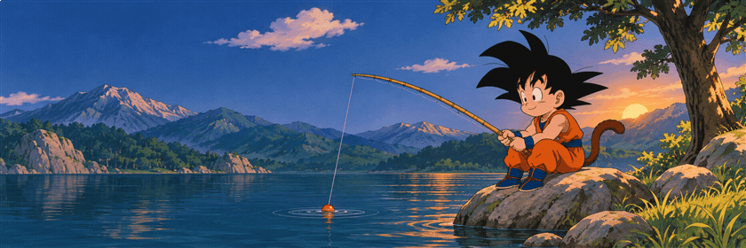

<picture>
  <source media="(prefers-reduced-motion: reduce)" srcset="assets/goku-fishing.webp">
  
</picture>

<h1 align="center">Michael Chen</h1>

I build forecasting models and AI agents, with a focus on commercial analytics and how to evaluate their outputs.

  <a href="https://mwc2150.github.io/">Portfolio</a> ·
  <a href="https://github.com/mcschlatt">USC projects</a>

## Selected projects

| Project | Focus |
| --- | --- |
| [PharmAgentics](https://github.com/mwc2150/PharmAgentics) | AI agents that explain weekly pharma brand performance and forecast changes, with each number traceable to its source. |
| [Qual2Cast](https://github.com/Qual2Cast/Qual2Cast) | Estimates private-company valuation multiples from public information by finding comparable companies and testing the method on held-out firms. |
| [AI Pulse](https://github.com/bruno-neira/AI-Pulse) | A visual analysis of how GPU capacity, training data, and compute spending have changed across frontier AI models. |
| [RL for LLM planning](https://github.com/jiayi-ong/optimized-llm-planning-memory) | Tests whether a memory compressor trained with reinforcement learning helps an LLM plan trips that meet more constraints. |

## Tools I’ve used

| Area | Tools |
| --- | --- |
| Forecasting and analytics | Python, Jupyter, pandas, NumPy, SciPy, statsmodels |
| Machine learning and agents | scikit-learn, XGBoost, PyTorch, Hugging Face Transformers, Gymnasium, Stable-Baselines3, Microsoft Agent Framework, MLflow |
| Visualization and publishing | R, ggplot2, Quarto, Matplotlib, HTML, CSS, JavaScript |
| Data and application engineering | SQL, DuckDB, BigQuery, Selenium, PRAW, FastAPI, Docker |

## Contribution history

<picture>
  <source media="(prefers-color-scheme: dark)" srcset="https://raw.githubusercontent.com/mwc2150/mwc2150/output/snake-dark.svg">
  
</picture>

[View my GitHub activity](https://github.com/mwc2150#contribution-activity)
